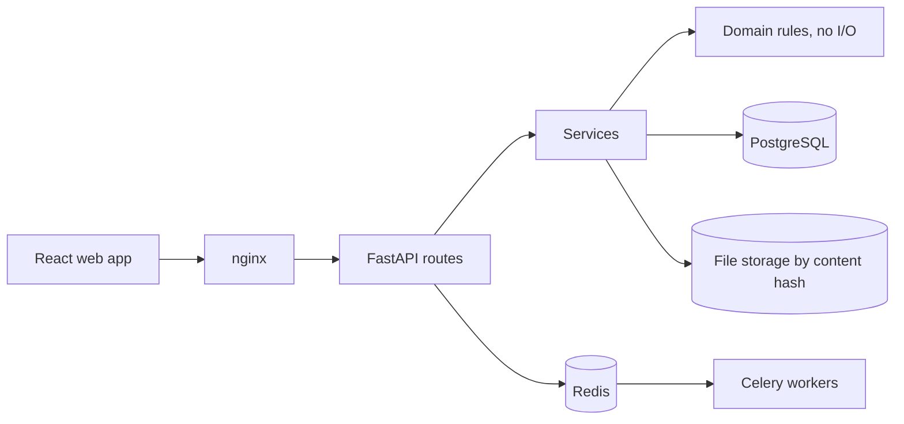

# 

A platform for checking, fixing and creating professional documents (DOCX, PDF and PPTX).

> **Status:** early. *Phase* 1 of 9 is finished: accounts, secure uploads, *version* history and the
> document library work end to end. Document analysis starts in Phase 2.

## 

Reports, theses and slide decks often have to follow strict rules: heading levels, numbering,
captions, margins, fonts and citation styles such as IEEE or APA. Checking all of that by hand is
slow and easy to get wrong.

AKSHARA is being built to do that work. You upload a document, it reads the structure, checks it
against a *standard*, explains what's wrong, and offers fixes you approve one by one. Later phases add
writing new documents and slide decks from a short brief.

Every uploaded file is kept as an unchangeable original, and each edit creates a new *version*, so
nothing is ever lost.

## 

- Sign up and log in, with secure sessions and rate-limited login
- Upload DOCX, PDF and PPTX files up to 50 MB
- Safety checks on every upload: real file type from the contents, size limits, protection against
  *zip bombs*, and rejection of files with *macros*
- Original files stored once and never changed, with a *version* record for each one
- A document library with search, plus dashboard and settings pages

## 

| Phase | What it adds |
|---|---|
| 2. Document intelligence | Read all three formats into one internal model and preview the pages |
| 3. Inspection | Find structure and formatting problems, graded by severity, with a quality report |
| 4. Standards | Built-in IEEE, APA and MLA rule sets, custom rules and compliance reports |
| 5. Editing | Tracked edits and grammar fixes, and automatic corrections you approve first |
| 6. Generation | Write documents from a brief, section by section, and export to DOCX or PDF |
| 7. Presentations | Generate slide decks with themes, layouts and speaker notes |
| 8. Visual checks | Spot layout problems such as text running off the page or blank pages |
| 9. Research | Find and verify sources and references |

The full plan is in [docs/ARCHITECTURE.md](docs/ARCHITECTURE.md), with design decisions in
[docs/adr](docs/adr).

## 

1. The React web app sends the file to the API.
2. The API checks the file is safe and really is the type it claims to be.
3. The file is stored by its content hash, so the same file is never stored twice, and a *version*
   record is added to PostgreSQL.
4. Slower work will run in background workers through Celery and Redis. The worker is set up and
   tested in *Phase* 1, but the real jobs (parsing and checking) arrive in Phases 2 and 3.

## 



The code is layered: routes call services, services call the database and storage, and the core rules never touch I/O. An automated check keeps those layers apart.

## 

<p align="center">
  
  
  
  
  
  
  
  
  
  
  
  
</p>

| Layer | Technology |
|---|---|
| API | Python 3.12, FastAPI, Pydantic |
| Data | PostgreSQL 16, SQLAlchemy, Alembic |
| Background jobs | Celery, Redis 7 |
| Web app | React, TypeScript, Vite, Tailwind CSS, TanStack Query, React Bits |
| Infrastructure | Docker Compose, nginx |
| Quality | pytest, Vitest, ruff, mypy (strict), import-linter, ESLint |

## 

### 

```bash
git clone https://github.com/Iamshi-vissa/Akshara.git
cd Akshara
cp .env.example .env    # then set AKSHARA_JWT_SECRET and POSTGRES_PASSWORD
docker compose up -d --build
```

Open <http://localhost:8080>.

To make a JWT secret: `python -c "import secrets; print(secrets.token_urlsafe(48))"`

### 

You need Python 3.12+, [uv](https://docs.astral.sh/uv/), Node.js 22, PostgreSQL 16 and Redis 7.

```bash
cp .env.example backend/.env    # point AKSHARA_DATABASE_URL at your database
make install                    # backend and frontend dependencies
make migrate                    # create the database tables
make dev-api                    # API at http://localhost:8000/api/docs
make dev-web                    # web app at http://localhost:5173
```

Run `make help` to see every command.

## 

```bash
make lint     # ruff, mypy, import-linter, TypeScript and ESLint
make test     # 81 backend tests (needs PostgreSQL and Redis) and 13 frontend tests
```

The backend tests create and delete their own database, `akshara_test`. Don't point them at real
data. A browser end-to-end check is described in [e2e/README.md](e2e/README.md).

## 

```
backend/    FastAPI app, database migrations, background workers and tests
frontend/   React web app
infra/      Dockerfiles and nginx config
docs/       architecture plan and design decisions
e2e/        browser end-to-end check
```

## 

MIT. See [LICENSE](LICENSE).
